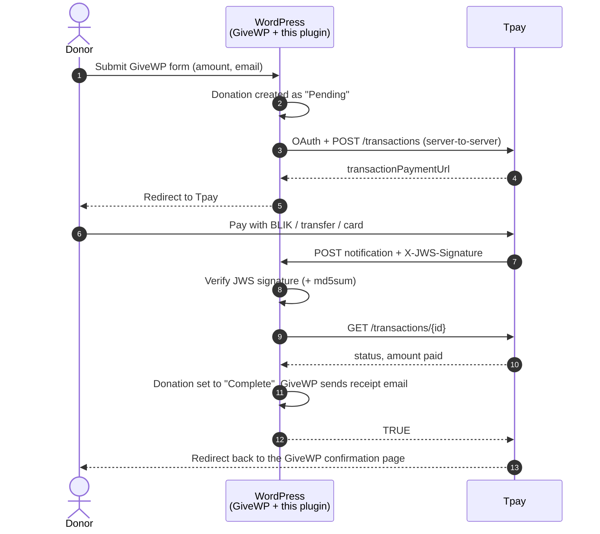

# Tpay Payment Gateway for GiveWP

**🇬🇧 English** · [🇵🇱 Polski](README.pl.md)

Accept donations in your WordPress site with **[GiveWP](https://wordpress.org/plugins/give/)** and **[Tpay](https://tpay.com)**: BLIK, Polish bank transfers and cards. The donor fills in the GiveWP form, pays on Tpay's secure page, and the donation is marked **complete only after a signed Tpay notification has been verified against the Tpay API**. After that, GiveWP sends the thank-you email.

Built for [Ostoja](https://ostoja.gda.pl). Free and open source (GPL-2.0-or-later). Any organisation that uses GiveWP and Tpay can use it.

> **Status: 0.1.0, sandbox testing.** Do not switch to production until you have run the [test checklist](#5-test-in-sandbox).

---

## Features

- **Off-site payment.** Card and bank data never touch your site. Donors pay on Tpay (BLIK, pay-by-link, cards, Google Pay and Apple Pay, depending on your Tpay account).
- **Verified payments only.** Each notification is checked three ways: its JWS signature (certificate chain pinned to Tpay's root CA), an optional `md5sum` check, and a fresh `GET /transactions/{id}` that must match the donation's ID, amount and currency.
- **No keys in the browser.** API keys live in `wp-config.php` or in write-only admin fields. The front end gets nothing but a help text.
- **Idempotent.** Repeated or parallel notifications never complete a donation twice or send duplicate emails.
- **Refunds.** Tpay `CHARGEBACK` notifications mark the donation as *Refunded*.
- **Works with both GiveWP form types:** Visual Form Builder (v3) and Option-Based Form Editor (v2).
- **Sandbox and production** environments, plus a "Test connection" button in the admin.
- Everything else is standard GiveWP: forms, donor list, reports, CSV export, receipts and GDPR tools.

## How it works



When the donor returns to your site, the donation status does **not** change. Only the verified notification can mark a donation as paid.

Everything runs on your existing WordPress hosting. No extra server or SaaS is needed.

| Component | Responsibility |
|---|---|
| GiveWP | Forms, donations, donors, reports, emails, GDPR |
| This plugin | Talks to Tpay, verifies notifications, updates donation status |
| Tpay | Payment page, BLIK, banks, cards, payouts |
| SMTP/API mail plugin (optional) | Reliable delivery of GiveWP emails, see [Emails](#emails) |

## Requirements

- WordPress 6.0+, PHP 7.4+ with OpenSSL
- GiveWP 3.x or 4.x, with currency set to **PLN**
- HTTPS, and your server must be able to make outgoing HTTPS requests to `*.tpay.com`
- A Tpay merchant account with **Open API** keys

## Installation

### 1. Install the plugin

1. Download `ostoja-tpay-givewp-x.y.z.zip` from [Releases](../../releases).
2. In WordPress go to **Plugins → Add New → Upload Plugin**, choose the ZIP, then **Install** and **Activate**.
   GiveWP must be installed and active first.

### 2. Get your Tpay keys

In the **Tpay Merchant Panel**:

1. **Integration → API**: generate **Open API** keys (Client ID and Client Secret). Sandbox and production keys are different; start with sandbox.
2. Optional: **Notifications → Security**: copy the *security code* to enable the extra `md5sum` check.

### 3. Configure the keys

**Recommended:** add the keys to `wp-config.php`, above the line `/* That's all, stop editing! */`:

```php
define('OSTOJA_TPAY_SANDBOX', true);            // false = production
define('OSTOJA_TPAY_CLIENT_ID', 'your-client-id');
define('OSTOJA_TPAY_CLIENT_SECRET', 'your-client-secret');
define('OSTOJA_TPAY_SECURITY_CODE', 'your-security-code'); // optional
```

This way the keys never reach the database, database backups or the admin UI.

**Alternative:** go to **Donations → Settings → Payment Gateways → Tpay** and enter the keys there. Secret fields are write-only: a saved secret is never shown again, and leaving the field empty keeps the current value.

### 4. Enable the gateway

1. **Donations → Settings → General → Currency**: set **Polish Złoty (PLN)**.
2. **Donations → Settings → Payment Gateways → Gateways**: enable **Tpay** for the form types you use.
3. **Donations → Settings → Payment Gateways → Tpay**: click **Test connection with Tpay**. You should see a green confirmation.

### 5. Test in sandbox

- [ ] Make a donation, get redirected to Tpay sandbox, pay, return to the confirmation page.
- [ ] Within a few seconds the donation is **Complete** with the note *"Płatność potwierdzona przez Tpay (TR-…)"* (plugin messages are currently in Polish).
- [ ] The donor receives the GiveWP receipt email.
- [ ] An abandoned payment stays **Pending**.
- [ ] `curl -X POST "<notification URL>"` returns `401 FALSE`. The notification URL is shown on the Tpay settings screen.
- [ ] **Donations → Tools → Logs** shows no `Tpay:` errors.

### 6. Go live

Switch to production keys, set `OSTOJA_TPAY_SANDBOX` to `false` (or choose *Production* in settings), click *Test connection*, and make one small real donation.

## Emails

GiveWP sends donor receipts and admin notifications through `wp_mail()`. For reliable delivery, install a mail plugin such as **FluentSMTP** or **WP Mail SMTP**, connect it to a transactional email provider's **API** (Brevo, Amazon SES, Mailgun, Postmark, SendGrid…), and keep the provider's API key in `wp-config.php`. Also set up SPF, DKIM and DMARC for your domain.

## Troubleshooting

| Symptom | Likely cause |
|---|---|
| Donors see "Nie udało się rozpocząć płatności" (could not start the payment) | Wrong keys or wrong environment (sandbox keys with production selected). Use *Test connection*, then check the donation notes. |
| Donation stays *Pending* after a successful payment | The notification is not reaching your site. Common causes: a security plugin (Wordfence), Cloudflare Bot Fight Mode, a `www` ↔ non-`www` or HTTP → HTTPS redirect, or maintenance mode. Check **Donations → Tools → Logs**. |
| `Tpay: odrzucono powiadomienie z nieprawidłowym podpisem JWS` (invalid JWS signature) in logs | The environment doesn't match the account sending the notification, or outgoing HTTPS to `secure.tpay.com` is blocked. |

## Security

- Secrets are used server-side only and never rendered in HTML, not even as password field values.
- The notification endpoint accepts only `POST` requests signed by Tpay. The signing certificate URL is pinned per environment, so the plugin never fetches attacker-supplied URLs, and the certificate must chain to Tpay's root CA and be within its validity period.
- The donation status changes only after the transaction is re-fetched from the Tpay API and the ID, `hiddenDescription`, amount and currency all match.
- The payment redirect URL must be HTTPS on `tpay.com`.

Found a vulnerability? Please report it privately via GitHub Security Advisories, not in a public issue.

## Development

```bash
bin/test.sh          # php -l + JWS verifier tests on PHP 7.4 and 8.3 (Docker)
DOCKER=0 bin/test.sh # same, using local PHP
bin/build-zip.sh     # dist/ostoja-tpay-givewp-<version>.zip
```

Releases: bump `Version:` in `ostoja-tpay-givewp/ostoja-tpay-givewp.php` and `Stable tag` in `readme.txt`, then push a tag `vX.Y.Z`. GitHub Actions runs the tests and attaches the ZIP to a GitHub Release.

```
ostoja-tpay-givewp/       WordPress plugin (this folder goes into the ZIP)
├── ostoja-tpay-givewp.php  bootstrap, gateway registration
├── src/TpayGateway.php     GiveWP gateway: create payment, handle notification
├── src/TpayApi.php         Tpay Open API client (OAuth, transactions)
├── src/JwsVerifier.php     notification signature verification
├── src/Settings.php        admin settings section
├── src/Config.php          wp-config constants / settings
└── assets/js/              gateway registration for Visual Form Builder
tests/                    standalone tests
bin/                      test and build scripts
```

## Roadmap

- Poll Tpay for donations still pending after N hours, in case a notification was lost
- Refunds started from the GiveWP admin through the Tpay API
- Recurring donations

## License

GPL-2.0-or-later, see [LICENSE](LICENSE).

*Tpay is a trademark of Krajowy Integrator Płatności S.A. GiveWP is a trademark of its owners. This project is independent and is not affiliated with or endorsed by either of them.*
