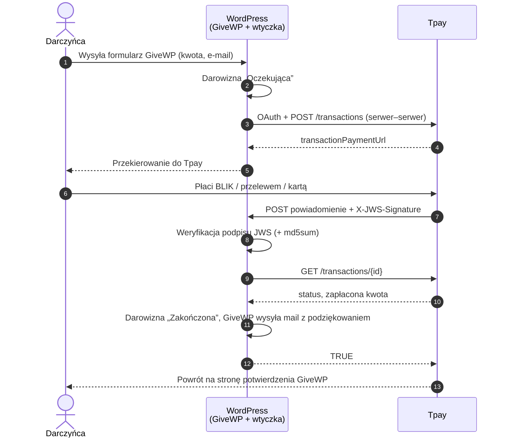

# Bramka Tpay dla GiveWP

[🇬🇧 English](README.md) · **🇵🇱 Polski**

Wtyczka pozwala zbierać darowizny na stronie WordPress przez **[GiveWP](https://wordpress.org/plugins/give/)** i **[Tpay](https://tpay.com)**: BLIK, przelewy i karty. Darczyńca wypełnia formularz GiveWP i płaci na bezpiecznej stronie Tpay. Darowizna dostaje status **„Zakończona” dopiero wtedy, gdy podpisane powiadomienie Tpay zostanie sprawdzone w API Tpay**. Wtedy GiveWP wysyła mail z podziękowaniem.

Wtyczka powstała dla [Ostoi](https://ostoja.gda.pl). Jest darmowa i otwarta (GPL-2.0-or-later). Może z niej korzystać każda organizacja, która używa GiveWP i Tpay.

> **Status: 0.1.0, testy w Sandboxie.** Nie przełączaj na produkcję przed przejściem [listy testów](#5-testy-w-sandboxie).

---

## Funkcje

- **Płatność na stronie Tpay.** Dane kart i logowania do banku nie trafiają na Twoją stronę. Dostępne metody (BLIK, przelewy, karty, Google Pay, Apple Pay) zależą od konta Tpay.
- **Tylko potwierdzone płatności.** Każde powiadomienie jest sprawdzane na trzy sposoby:
  - podpis JWS, z łańcuchem certyfikatów do głównego certyfikatu Tpay,
  - opcjonalnie suma `md5sum`,
  - ponowne pobranie transakcji (`GET /transactions/{id}`), której ID, kwota i waluta muszą zgadzać się z darowizną.
- **Żadnych kluczy w przeglądarce.** Klucze są w `wp-config.php` albo w polach panelu „tylko do zapisu”. Do przeglądarki trafia wyłącznie tekst informacyjny.
- **Idempotencja.** Powtórzone lub równoległe powiadomienie nie zakończy darowizny drugi raz ani nie wyśle drugiego maila.
- **Zwroty.** Powiadomienie `CHARGEBACK` z Tpay oznacza darowiznę jako „Zwróconą”.
- **Oba typy formularzy GiveWP:** Visual Form Builder (v3) i Option-Based Form Editor (v2).
- **Sandbox i produkcja**, plus przycisk „Testuj połączenie” w panelu.
- Reszta to standardowe GiveWP: formularze, lista darczyńców, raporty, eksport CSV, potwierdzenia, narzędzia RODO.

## Jak to działa



Powrót darczyńcy na stronę **nie** zmienia statusu darowizny. Jako opłaconą może ją oznaczyć wyłącznie zweryfikowane powiadomienie.

Wszystko działa na Waszym obecnym hostingu WordPressa. Nie potrzeba dodatkowego serwera ani usługi w chmurze.

| Element | Za co odpowiada |
|---|---|
| GiveWP | Formularze, darowizny, darczyńcy, raporty, maile, RODO |
| Ta wtyczka | Komunikacja z Tpay, weryfikacja powiadomień, zmiana statusu |
| Tpay | Strona płatności, BLIK, banki, karty, wypłaty |
| Wtyczka do maili (opcjonalnie) | Niezawodne doręczanie maili GiveWP, zob. [Maile](#maile) |

## Wymagania

- WordPress 6.0+, PHP 7.4+ z OpenSSL
- GiveWP 3.x lub 4.x z walutą **PLN**
- HTTPS i możliwość wychodzących połączeń HTTPS do `*.tpay.com`
- Konto Tpay z kluczami **Open API**

## Instalacja

### 1. Instalacja wtyczki

1. Pobierz `ostoja-tpay-givewp-x.y.z.zip` z zakładki [Releases](../../releases).
2. W WordPressie wejdź w **Wtyczki → Dodaj nową → Wyślij wtyczkę na serwer**, wybierz plik ZIP, kliknij **Zainstaluj**, a potem **Włącz**.
   GiveWP musi być wcześniej zainstalowane i włączone.

### 2. Klucze Tpay

W **Panelu Akceptanta Tpay**:

1. **Integracja → API**: wygeneruj klucze **Open API** (Client ID i Client Secret). Klucze Sandbox i produkcyjne są różne; zacznij od Sandboxa.
2. Opcjonalnie **Powiadomienia → Bezpieczeństwo**: skopiuj *kod bezpieczeństwa*, żeby włączyć dodatkową weryfikację `md5sum`.

### 3. Konfiguracja kluczy

**Zalecane:** dopisz klucze do `wp-config.php`, powyżej linii `/* That's all, stop editing! */`:

```php
define('OSTOJA_TPAY_SANDBOX', true);            // false = produkcja
define('OSTOJA_TPAY_CLIENT_ID', 'twoj-client-id');
define('OSTOJA_TPAY_CLIENT_SECRET', 'twoj-client-secret');
define('OSTOJA_TPAY_SECURITY_CODE', 'twoj-kod-bezpieczenstwa'); // opcjonalnie
```

Klucze nie trafią wtedy ani do bazy danych, ani do jej kopii zapasowych, ani do panelu.

**Alternatywnie:** wejdź w **Darowizny → Ustawienia → Bramki płatności → Tpay** i wpisz klucze tam. Pola sekretów są „tylko do zapisu”: zapisany sekret nie jest już nigdy wyświetlany, a puste pole przy zapisie zachowuje obecną wartość.

### 4. Włączenie bramki

1. **Darowizny → Ustawienia → Ogólne → Waluta**: ustaw **złoty polski (PLN)**.
2. **Darowizny → Ustawienia → Bramki płatności → Bramki**: włącz **Tpay** dla używanych typów formularzy.
3. **Darowizny → Ustawienia → Bramki płatności → Tpay**: kliknij **Testuj połączenie z Tpay**. Powinien pojawić się zielony komunikat.

### 5. Testy w Sandboxie

- [ ] Darowizna, przekierowanie do Sandboxa Tpay, płatność, powrót na stronę potwierdzenia.
- [ ] Po kilku sekundach darowizna ma status **Zakończona** i notatkę *„Płatność potwierdzona przez Tpay (TR-…)”*.
- [ ] Darczyńca dostał mail z potwierdzeniem GiveWP.
- [ ] Porzucona płatność zostaje jako **Oczekująca**.
- [ ] `curl -X POST "<adres powiadomień>"` zwraca `401 FALSE`. Adres powiadomień jest widoczny w ustawieniach Tpay.
- [ ] W **Darowizny → Narzędzia → Logi** nie ma błędów „Tpay:”.

### 6. Produkcja

Wpisz klucze produkcyjne, ustaw `OSTOJA_TPAY_SANDBOX` na `false` (albo wybierz *Produkcja* w ustawieniach), kliknij *Testuj połączenie* i zrób jedną małą, prawdziwą darowiznę.

## Maile

GiveWP wysyła potwierdzenia dla darczyńców i powiadomienia dla administratora przez `wp_mail()`. Żeby maile docierały, zainstaluj wtyczkę **FluentSMTP** lub **WP Mail SMTP** i podłącz ją przez **API** do dostawcy maili transakcyjnych (Brevo, Amazon SES, Mailgun, Postmark, SendGrid…). Klucz API dostawcy trzymaj w `wp-config.php`. Skonfiguruj też SPF, DKIM i DMARC dla domeny.

## Rozwiązywanie problemów

| Objaw | Prawdopodobna przyczyna |
|---|---|
| Darczyńca widzi „Nie udało się rozpocząć płatności” | Złe klucze albo złe środowisko (np. klucze Sandbox przy wybranej produkcji). Kliknij *Testuj połączenie* i sprawdź notatki darowizny. |
| Darowizna zostaje „Oczekująca” mimo udanej płatności | Powiadomienie nie dociera do strony. Najczęstsze przyczyny: wtyczka bezpieczeństwa (Wordfence), Cloudflare Bot Fight Mode, przekierowanie `www` ↔ bez `www` albo HTTP → HTTPS, tryb konserwacji. Sprawdź **Darowizny → Narzędzia → Logi**. |
| W logach „Tpay: odrzucono powiadomienie z nieprawidłowym podpisem JWS” | Środowisko nie zgadza się z kontem, które wysyła powiadomienie, albo serwer nie może połączyć się z `secure.tpay.com`. |

## Bezpieczeństwo

- Sekrety są używane wyłącznie po stronie serwera i nie trafiają do HTML, nawet jako wartość pola hasła.
- Adres powiadomień przyjmuje tylko żądania `POST` podpisane przez Tpay. Adres certyfikatu jest przypięty osobno dla każdego środowiska, więc wtyczka nigdy nie pobiera adresów podanych przez nadawcę. Certyfikat musi prowadzić do głównego certyfikatu Tpay i być ważny.
- Status zmienia się dopiero po ponownym pobraniu transakcji z API Tpay i zgodności ID, `hiddenDescription`, kwoty i waluty.
- Adres płatności musi być w domenie `tpay.com` i używać HTTPS.

Znalazłeś podatność? Zgłoś ją prywatnie przez GitHub Security Advisories, nie w publicznym zgłoszeniu (issue).

## Dla programistów

```bash
bin/test.sh          # php -l + testy weryfikacji JWS na PHP 7.4 i 8.3 (Docker)
DOCKER=0 bin/test.sh # to samo na lokalnym PHP
bin/build-zip.sh     # dist/ostoja-tpay-givewp-<wersja>.zip
```

Nowe wydanie: podbij `Version:` w `ostoja-tpay-givewp/ostoja-tpay-givewp.php` i `Stable tag` w `readme.txt`, a potem wypchnij tag `vX.Y.Z`. GitHub Actions uruchomi testy i dołączy plik ZIP do GitHub Release.

## Plany

- Automatyczne sprawdzanie w Tpay darowizn, które są „Oczekujące” od wielu godzin (na wypadek zgubionego powiadomienia)
- Zwroty zlecane z panelu GiveWP przez API Tpay
- Darowizny cykliczne

## Licencja

GPL-2.0-or-later, zob. [LICENSE](LICENSE).

*Tpay jest znakiem towarowym Krajowego Integratora Płatności S.A. GiveWP jest znakiem towarowym swoich właścicieli. Projekt jest niezależny i nie jest powiązany z żadną z tych firm ani przez nie wspierany.*
